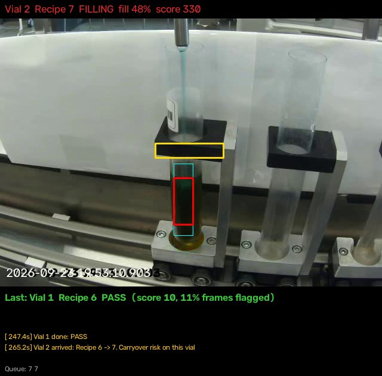

# Live mode

Runs the full check on a live camera at the fill station:

```
camera -> calibration -> liquid finder -> vial tracker + recipe queue -> Phase 2 score -> verdict + cause
```



*This earlier screen capture is a visual reference only; it predates the
current verdict panel and does not represent the latest replay results.*

## Recorded video and live camera inputs

On video 5, the label file tells the code which recipe each vial runs and when
it fills. A live camera sends pictures only. Live mode supplies both itself:

- **Timing from the camera.** The tracker sees each vial arrive, the liquid
  start to rise, and the vial leave.
- **Recipe from the operator.** Before the run, the operator types the recipe
  queue the machine will execute. Each arriving vial takes the next recipe.

The recipe never comes from the vial's color. A check that guesses the recipe
from the color it sees would pass any contaminated vial.

A different camera view also breaks the finder, since it looks for the vial at
fixed pixel positions. A one-time calibration fixes that.

## Setup

Same environment as the rest of the repo. For the live window on Windows or
macOS, swap the headless OpenCV build for the full one:

```
pip uninstall -y opencv-python-headless
pip install opencv-python
```

Without a screen (Linux server), live mode runs without a window. Add
`--record screen.mp4` to save what the window would show.

Set the import path from the repo root:

```
set PYTHONPATH=src          (Windows)
export PYTHONPATH=src       (macOS / Linux)
```

## Step 1: Calibrate (once per camera setup)

Put a vial under the nozzle, then:

```
python -m vialsense.live_cli calibrate --camera 0
```

This saves `results/live/calibration.json` and a preview,
`results/live/calibration.jpg`. Open the preview: in the right half, the holder
block under the nozzle must sit inside the yellow box.

- Wrong camera: try `--camera 1` or `--camera 2`. Network camera: `--stream rtsp://...`
- Wrong holder picked: pass it yourself, in the 640x480-resized frame:
  `--holder CENTER_X BOTTOM_Y WIDTH`
- Same view as Dataset 2: calibration finds no change and leaves frames as they are.

## Step 2: Run

Type the recipes in the order the machine runs them, one per vial:

```
python -m vialsense.live_cli run --camera 0 --recipes "7x3,8x3" --previous-recipe 6
```

- `--recipes "7,7,7,8,8,8"` and `--recipes "7x3,8x3"` mean the same thing.
- `--previous-recipe` is the recipe that ran just before. It makes the first
  vial's carryover check possible. Leave it out if unknown.
- Start the program before the first vial arrives, so the vial count stays in step.

### Keys

| Key | Use |
|---|---|
| `q` | Quit and save results |
| `p` | Pause |
| `n` | A vial went by unseen: move the queue forward one |
| `b` | A vial was counted twice: move the queue back one |

### What the screen shows

- **Top bar:** vial number, recipe, state (WAITING FOR FILL, FILLING), fill
  percent, and the running score. Red when the frame scores unusual.
- **Boxes:** yellow = holder found, red = area measured for color.
- **Bottom panel:** the last vial's verdict and its explanation, recent events
  (including the recipe-change warning before a fill starts), and the queue.

### Verdicts

| Verdict | Meaning |
|---|---|
| PASS | Most clear readings fit the recipe's profile |
| FLAG | More than half of the clear readings score unusual (100 or more) |
| NO DATA | The fill start was not observed, or there were fewer than 3 clear readings for the fill stage |
| NO RECIPE | The queue ran out; color recorded only |

### Cause explanations for a FLAG

| Situation | Message |
|---|---|
| First vial after a recipe change, color closer to the previous recipe | Likely carryover from Recipe X |
| First vial after a recipe change, color unlike either recipe | Possible carryover: leftover mixed with the new liquid |
| Same recipe as the vial before | Not recipe-change carryover: check lighting, the vial, or the volume |
| First vial of the run, previous recipe unknown | Color off; previous recipe unknown |

## Outputs

Each run saves to `results/live/run_<date>_<time>/`:

- `vials.csv`: one row per vial, with recipe, timing, score, verdict, explanation
- `frames.csv`: one row per analysed frame
- `events.log`: arrivals, recipe changes, verdicts, operator key presses
- `run_summary.json`: counts

## Replay a recording as live

Tests live mode end to end, and works as a backup demo:

```
python -m vialsense.live_cli run --video data/raw/dataset2/vial_fill/videos/vial_fill_video_5.mp4 --recipes "5x3,6x3,7x3,8x3,9x3,10x3,11x3,12x3,13x3,14x3" --realtime
```

`--realtime` plays at real speed. Without it, the full 28-minute video runs in
about 45 seconds. `--start-s` starts partway in.

## Video 5 replay results

Current outputs are saved in [`results/live/video5_replay/`](results/live/video5_replay/).
The replay assigned all 30 vials in queue order and returned 20 `PASS`, 9
`FLAG`, and 1 `NO DATA`. Vial 1 arrived with liquid already visible and has no
previous recipe, so it was not assigned an assumed start or anomaly score.

The corrected labels provide 29 observed-start vials for timing comparison:
estimated starts differed by 0.84 s mean absolute error (4.06 s maximum), and
estimated ends differed by 0.72 s (3.03 s maximum).

The challenge description expects the first vial after a recipe change to show
possible carryover, while the second and third are expected to be clean. On
the 9 actual recipe transitions, 8 were flagged and 1 passed (the missed case
is Vial 13, Recipe 9, whose color is close to Recipe 8). Among the 10
second-position vials, 1 was flagged and 9 passed. The 10 third-position
vials were used to build the provisional profiles and are not independent
evaluation samples. Excluding those reference vials and the initial vial, 17
of 19 scored cases matched the expected pattern: 8/9 transition cases flagged
and 1/10 presumed-clean second vials flagged. These roles are based on the
challenge description, not confirmed contamination labels, so this is a
descriptive check rather than validated accuracy.

## Limits

- **Recipes need a profile.** The Phase 2 model has profiles for Recipes 5 to
  14 only. A recipe outside that set gets no score until a profile exists for it.
- **The queue must match the machine.** A wrong or shifted queue puts every
  later vial on the wrong recipe. Use `n` and `b` to fix it during a run.
- **Fixed camera exposure helps.** Webcams adjust brightness and white balance
  on their own, which shifts colors away from the recorded profiles. Lock both
  in the camera settings if it allows.
- **The live fill-start estimate is rough.** Pale or shallow liquids may be
  detected late. If liquid is already clearly visible on arrival, live scoring
  and final scoring are withheld because the start was not observed. Departure
  timing is used only when the start was observed.
- **No machine connection.** Reading the recipe and fill signals from the
  Batch Scheduler over OPC UA, read-only, is the production upgrade and would
  replace the typed queue.
- Not validated contamination detection. Dataset 2 has no lab-confirmed labels.
